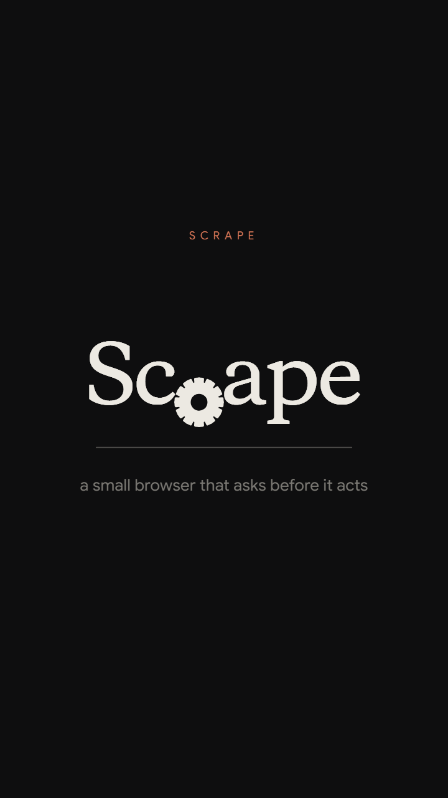

# Scrape

A minimal Rust browser: a Material You shell in egui, pages rendered by WebView2 (Chromium) inside the window.

[](docs/scrape-promo.mp4)

```powershell
cargo run --release
```

All settings live in one file, `%APPDATA%\Scrape\config.json`, and are edited on the `scrapeconfig:` page (search + groups): search engine, search history, tab unload time, whitelist, memory limit, agent endpoint/model/key, CDP port, splash, logo, clock, widgets and the welcome layout.

## Hotkeys

| Keys | Action |
|---|---|
| `Ctrl+L` | focus the address bar |
| `Ctrl+T` | new tab |
| `Ctrl+W` | close tab |
| `Ctrl+Shift+A` | agent panel |

## Window

There is no OS title bar: tabs, the logo and the minimize/maximize/close buttons are drawn in the top strip (like Chrome). Drag the strip to move, double-click to maximize. The window edges resize: the page is inset by 5 px so the grab zones stay clickable.

The "⋯" menu opens above the page and does not shift the layout: new tab, reload, close tab, recent searches (click repeats the query), clear history, incognito, unload background tabs, Theme, scrapeconfig and Setup mode. While the menu is open the native page is hidden, so the menu never falls under the WebView2.

A new tab is not a network page but a native welcome screen: clock, the "Scrape" logo, a splash phrase, a search field with the engine logo on the left (Google, Bing, DuckDuckGo, Perplexity, Yandex, Brave — drawn from PNGs in `assets/engines`, no network needed), a grid of favourite sites, the Claude phrase line and a TODO widget.

## Welcome screen

The layout is a free list of items, `scrape.welcome.layout` (type, position, scale), designed on a 1200×800 canvas: when the window shrinks the canvas scales and centres as a whole and every item stays exactly at its own coordinates — nothing pushes anything else. If an item ends up fully below the window bottom it is not drawn, and the rest stay put (the logo does not shrink). By default the welcome screen shows the logo, splash, search and site grid: no clock, TODO or Claude phrase line — they can be brought back from Setup mode. The "⋯" menu has **Setup mode**: a badge in the top right, any item can be selected, dragged, changed in the inspector, deleted, added again or the layout can be reset. All of it without `scrapeconfig`.

- **Sites** — the grid of favourite sites right under the search field. Six tiles by default in a 1×8 grid; rows and columns are set separately (1…8 each) in Setup mode, extra tiles scroll below. URLs are edited there too. Icons come from `%APPDATA%\Scrape\favicons` (cache) and are downloaded via DuckDuckGo/Google on first display; in incognito the network is not touched and only the cache is used. If there is no icon, a letter is drawn.

- **Splash** — `scrape.splash.mode` (Off/On/Custom) and `scrape.splash.custom_splash` (comma-separated list). In On mode time-of-day phrases ("late night jam session.") are mixed into the base phrases. The phrase is picked once per entry: it does not rotate on screen, but the next entry shows another one.
- **Logo** — `scrape.logo.preference`: `basic` (a gear instead of `r`), `plain` (text only), `big` (gear above the text).
- **Clock** — `scrape.clock.font` (`anthropic serif`, `google sans`, `geist` or a path to a `.ttf`), `scrape.clock.orientation` (horizontal `00:00` / vertical), `scrape.clock.seconds`.
- **Widgets** — a Nothing-styled TODO (black, red, NDot) or Claude-styled one (warm grey, orange), and the Claude phrase line ("thinking", "baking", "ultrathink"…) with a spinning star. Also refreshed on every entry.

The Anthropic Serif, Geist, NDot and Google Sans fonts are bundled from `assets/fonts` — no network and no installed fonts needed; if a file is missing, Segoe UI is used.

## Theme

The **Theme** panel: light/dark scheme, seed colour, wallpaper (local file), corner radius, font scale, top/side tabs, preview and `.scrp` export/import (JSON with theme parameters). The MD3 palette is built from the seed or from the wallpaper's dominant colour (CIELAB hue). The wallpaper shows on the welcome screen and on `scrapeconfig:`; `scrape.theme.wallpaper.blur` blurs it. Animated GIF/WebP play, mp4 is not supported — the stack has no video decoder.

## Agent

The **Agent** button opens a side panel. It talks to any OpenAI-compatible `/chat/completions` endpoint (DeepSeek by default); the key is yours and is stored in plain text in `config.json`.

A permission prompt comes before the first action: without it the agent neither reads the page nor clicks anything. Tools: `read_page` (title, url, visible text), `open_url`, `click` (CSS selector or visible text), `fill`. Up to 5 call rounds per request, the page answers within 30 s. HTTP runs on a background thread, the page is only touched from the UI thread.

The input field sends on **Enter**, a newline is **Shift+Enter**, there is no separate send button. Above the field are the model and the status (`idle`, `thinking…`, `working…`), below it a wide context-fill bar and percentage. The model comes from the endpoint's response (`model`), otherwise from `scrape.agent.model`; it is also inserted into the system prompt, so the agent can name it. The fill is `usage.prompt_tokens` of the last request (if the endpoint does not report it, an estimate from message length) against `scrape.agent.context_tokens`.

The panel slides in and out; `Ctrl+Shift+A` opens/closes it.

For external tools (Playwright and the like) CDP can be enabled: `scrape.agent.cdp_port` (for example 9222). The port applies on the next launch, because WebView2 reads its arguments once.

## History and incognito

Search queries (not URLs) are stored in `config.json`, newest first, up to 100. `scrape.history.collect` turns collection off, `scrape.history.clear` deletes what was recorded. Incognito is a toggle in the "⋯" menu: the mode lasts for the current run only (it is not written to the config), it blocks history recording and the agent's access to the page (`read_page`, `click`, `fill`), and site icons are not downloaded from the network. The first attempt to record or read something shows a warning. It is not a separate WebView2 profile: Chromium cookies and cache are shared, full isolation would need its own profile.

## Memory and tabs

Every tab has its own page; a background tab is hidden but alive. Every 20 s it checks:

- a tab has been inactive longer than `scrape.tabs.unload_after_minutes` minutes;
- the combined working set of `scrape.exe` plus all `msedgewebview2.exe` exceeds `scrape.tabs.memory_limit_mb`.

Then that tab's page is destroyed (url and title stay; it loads again on activation). Domains in `scrape.tabs.unload_whitelist` are never unloaded.

## What is implemented

- A window without the OS frame, with its own tabs and buttons; resize from the edges, drag by the strip.
- Address bar with search-engine logos, back/forward/reload navigation.
- Dynamic MD3 palette plus a theme editor with live apply, wallpaper with blur and animation, `.scrp`.
- `scrapeconfig:` with 30 keys, search and saving to JSON; exit via the cross next to the search or `Esc`.
- AI agent: chat (Enter to send, Shift+Enter for a newline), permission, 4 tools, CDP, model/status above the field, context bar below it and panel animation.
- Page pool: unload by inactivity and by memory limit.
- Welcome screen: splash, logo in three variants, clock, TODO and Claude phrases, site grid with icon cache, setup mode with dragging and scaling.
- Search history with collection off switch and session-only incognito that blocks history and agent page access.
- App icon (orange gear-R) in the exe, window, taskbar and alt-tab; fonts bundled with a fallback. `assets/icon.ico` is rebuilt by `cargo test --release write_icon_ico -- --ignored`.

## What is not there yet

- Profiles, extensions, WASM plugins; browsing history (only search history is stored), bookmarks as a separate list (the site grid plays that role).
- Unloading never touches the active tab; the memory limit counts by process name, so other WebView2 hosts add to the sum too.
- Video wallpapers (mp4/webm): a separate decoder is needed, currently only images and animated GIF/WebP.
- Dragging tabs; welcome items are draggable only in Setup mode.

## Memory (release, Windows 11)

| | Working set | Private |
|---|---|---|
| shell `scrape.exe` | ~106 MB | ~47 MB |
| WebView2, `about:blank` | +296 MB | +137 MB |

The "<100 MB on an empty page" goal is unreachable on WebView2: it is Chromium in separate processes. That would need an engine without Chromium (Obscura paints the page into a CPU screenshot, but without interactive rendering).
